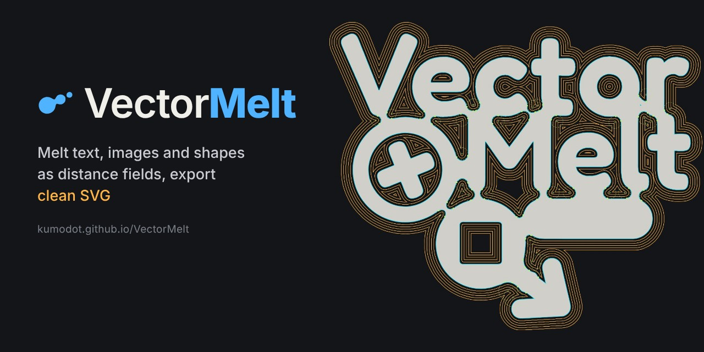
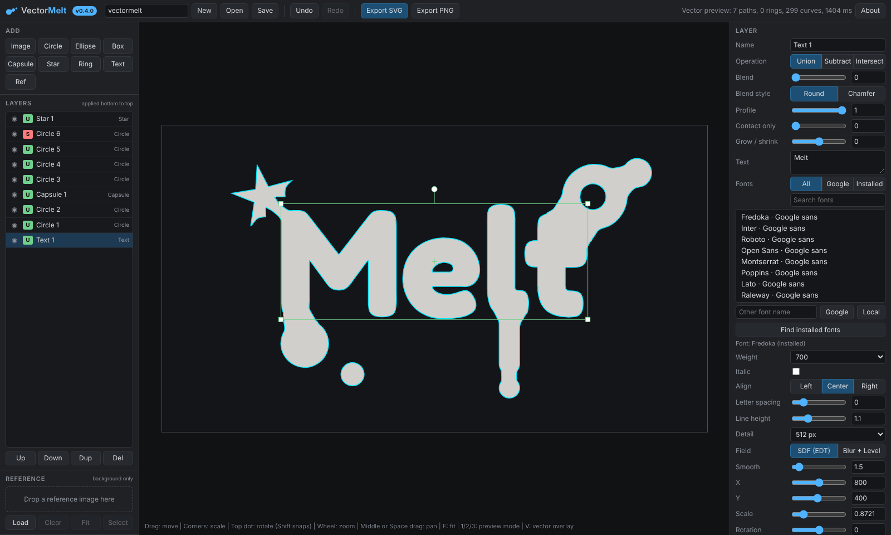
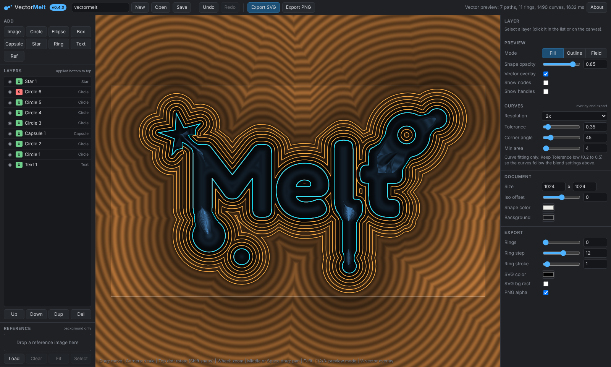
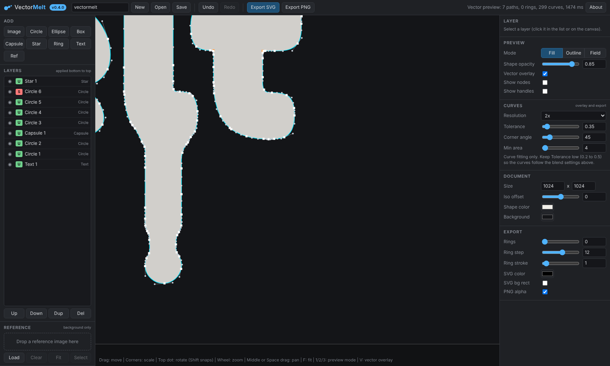

<p align="center">
  <a href="https://github.com/kumodot/VectorMelt/releases/latest"></a>
  
  
  
</p>
<p align="center">
  <a href="https://kumodot.github.io/VectorMelt/"></a>
  <a href="https://github.com/kumodot/VectorMelt/archive/refs/heads/main.zip"></a>
  <a href="https://ko-fi.com/msouza3d"></a>
</p>



VectorMelt melts black and white images, text and simple shapes together like metaballs, then gives you clean SVG. Every layer becomes a signed distance field (SDF), layers are combined with smooth booleans you tune per layer, and the result is traced into Bezier curves you can see live on top of the preview before you export.

## Screenshots

| | |
| --- | --- |
|  |  |
| Text layer (Google or installed fonts) melted with circles, a star and a capsule. | *Field* preview with offset *Rings*, exported as extra stroked paths. |
|  | |
| Live vector overlay: the same curves the SVG export writes. | |

## Run it

- **Online**: https://kumodot.github.io/VectorMelt/
- **Local**: download the repo and double click `VectorMelt_v0.6.0.html` (or `index.html`). No install, no server. Chrome or Edge recommended (WebGL2). Google Fonts need an internet connection; everything else works offline.

## Workflow

**Layers** (left panel, applied bottom to top)
- *Image* / *SVG*: drop black and white images (logos, lettering, scans) or SVG files. SVG stays a vector and is rasterized at the layer *Resolution*. Threshold (Otsu or manual), auto invert, *Smooth*, or the *Blur + Level* field.
- *Text*: type text, pick a font. Filter *All* / *Google* / *Installed*, search, *Other font name* for any Google family or local font, *Find installed fonts* (Chrome / Edge ask permission). *Weight*, *Italic*, *Align*, *Letter spacing*, *Line height*, *Detail*.
- Shapes: *Circle*, *Ellipse*, *Box*, *Capsule*, *Star* (also polygons), *Ring*.
- *Ref*: a reference image in the background with *Opacity*, never part of the shape.

**Blending** (per layer)
- *Operation*: *Union*, *Subtract* (cut holes, image into image works), *Intersect*.
- *Blend*: blend radius. *Blend style*: *Round* or *Chamfer*.
- *Profile*: 0 is the classic soft SDF blend, 1 is an exact rolling ball fillet at this layer's junction (radius 0.6 x *Blend*), tangent to both edges at any angle, on shapes, text, images and SVG. *Fillet circles* in Preview shows the construction circles.
- *Contact only*: shapes that are only close do not bridge or bulge, the blend grows where they actually touch.
- *Grow / shrink*, move, scale (corner handles) and rotate (top dot) on the canvas.

**Exact fillets** (final shape)
- *Inner fillet*: rolling ball radius for every concave corner. *Outer round*: radius for every convex corner. Exact arcs on any input, including text, images and SVG.

**Preview and curves**
- *Fill*, *Outline* and *Field* modes, *Vector overlay* with *Show nodes* (orange = corner) and *Show handles*. A legend in the canvas corner tells which line is the live SDF edge (lavender) and which is the exported vector (cyan).
- *Curves* panel: *Resolution*, *Tolerance* (how far the Bezier curves may drift from the shape), *Corner angle*, *Min area*.

**Export**
- *Export SVG*: one even-odd filled path, optional *Rings* (offset contours, *Outside* / *Inside* / *Both*) as stroked `rings-outside` / `rings-inside` paths, *SVG color*, optional background rect.
- *Export PNG* (transparent or with background).

### Shortcuts

| Key | Action |
| --- | --- |
| Wheel | Zoom at cursor |
| Middle drag / Space + drag / drag on empty area | Pan |
| F | Fit document |
| 1 / 2 / 3 | Fill / Outline / Field preview |
| V | Vector overlay |
| Arrows (Shift = 10 px) | Nudge layer |
| Ctrl+D / Delete | Duplicate / delete layer |
| Ctrl+Z / Ctrl+Shift+Z | Undo / redo |
| Ctrl+S | Save project |

## Projects and files

- `.vmelt` project: JSON with every layer and the images embedded. Old `.vsdf` files (Vector SDF) still open.
- Export: `.svg` and `.png`.

## Tech notes

- WebGL2 fragment shader generated from the layer stack; image and text layers are float textures sampled with Catmull-Rom.
- Image / text field: threshold, Felzenszwalb Euclidean distance transform, sub-pixel edges from anti-aliasing, Gaussian smoothing.
- Blends: polynomial smooth min (soft) on the GPU; *Profile* fillets on a CPU grid: each layer field rendered separately, combined, junction closed / opened with exact distances (EDT), restricted to where the ball touches both edges; gradient based contact falloff.
- Exact fillets and rings: the field is rebuilt as a true distance field (EDT on both sides + sub-pixel edge), then closed / opened by the radii.
- Vector: the field is rendered on a grid on the GPU, traced with marching squares, sharp corners detected and recovered, then fitted with cubic Beziers (Schneider).

## Layout

```
index.html                 Pages entry: reads version.json, redirects to the versioned app
version.json               current version + entry file
VectorMelt_v0.6.0.html     the app (single file, no build step)
assets/logo.svg            logo / favicon
Samples/                   black and white test images
screenshots/               README images and banner
docs/                      release notes
README.md  CHANGELOG.md  LICENSE
```

## License

MIT. See [LICENSE](LICENSE).

Marcelo Souza / Kumodot.art - 2026 // @Msouza3d · [Support Marcelo Souza on Ko-fi](https://ko-fi.com/msouza3d)
